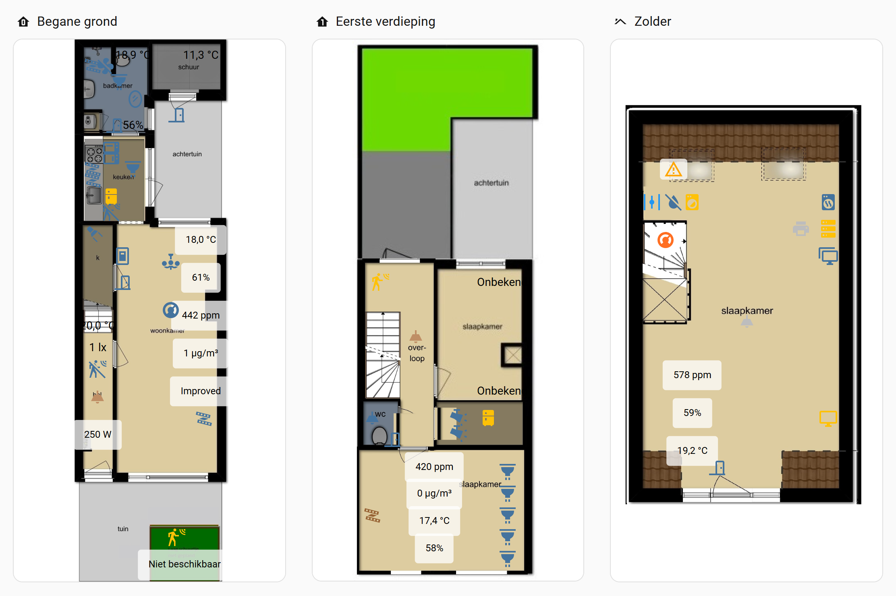

# Smarthome Cremerboulevard

This repository contains the set-up of my smart home, powered by the open-source project [Home Assistant](https://www.home-assistant.io).

I started around the beginning of the COVID pandemic with a few Philips Hue light bulbs, and the setup has grown from there.
Getting the configuration to where it is today took me several years of hobby time, mainly because I kept adding devices.
I use GitHub for version control and to share my configuration with others.

If you have any questions about my set-up or smart homes in general, feel free to [contact me](mailto:gerritjan@debruinhoegee.nl) or open an [issue](https://github.com/gerritjandebruin/home-assistant/issues/new)!

## The house
My house is in Utrecht, in a district called [New-England](https://nl.wikipedia.org/wiki/Nieuw_Engeland,_Thomas_%C3%A0_Kempisplantsoen_en_omgeving).
More specifically, I live on the Cremerstraat, a beautiful street with a view over the busiest railway track in the Netherlands and only a ten-minute walk from the city centre.
The house was built around 1920 and originally had a ground floor and one upper floor.
Over the years, toilets, a bathroom, a second floor (2017), a roof terrace (2020) and a bike shed (2020) were added.

Aerial photo of Utrecht around 1930. The arrow marks my street. On the right is the Dom tower, which I can see from the house as well. [Het Utrechts Archief](https://hetutrechtsarchief.nl/collectie/2C8CA0EEF8605EE4B7786F7C60876957).

### Floor plan

My main dashboard: a floor plan per storey (ground floor, first floor and attic) with the lights, doors, appliances and sensor readings on top.

## Devices
The following table lists the devices in my home automation.
When buying new devices, I keep the following in mind:
* Limit the number of different manufacturers. This helps when I replace devices later and gives more reproducible readings. I prefer manufacturers that are fairly large and have a good track record in long-term availability.
* Money. I am not willing to spend much extra for just a little value.
* Protocol. I am moving from Zigbee to [Matter](https://csa-iot.org/all-solutions/matter/), preferring Matter over Thread above Matter over WiFi. Thread devices form a low-power mesh network and do not congest the WiFi. My Google Nest Hub (2nd gen) acts as a Thread border router, bridging Thread devices to the IP network.

Hence, most of my devices come from IKEA :)
I prefer durability over low cost, so I tend to avoid cheap disposable hardware.

| Device | Manufacturer & Model | Protocol | Room | Price | Pcs |
|--------|----------------------|----------|------|-------|-----|
| Air conditioner | Midea MFEZ (Athena), 3.5 kW | WiFi | Attic (outdoor unit on the roof terrace) | - | 1 |
| Air quality sensor | [Apollo Automation AIR-1](https://apolloautomation.com/products/air-1) | WiFi (ESPHome) | Living room | €187 | 1 |
| Air quality sensor | IKEA ALPSTUGA | Matter (Thread) | Bedroom | - | 1 |
| Air quality sensor | [MoreSense MS05](https://www.moresense.nl) (CO₂, temp, humidity) | MQTT | Guest room, Attic | - | 2 |
| Button | IKEA BILRESA dual button | Matter (Thread) | Bathroom | - | 1 |
| Button | IKEA TRÅDFRI on/off switch | Zigbee | Bedroom, Attic (×2) | - | 3 |
| Button | IKEA TRÅDFRI shortcut button | Zigbee | Bedroom | - | 1 |
| Control outlet | [IKEA Askvader](https://www.ikea.com/nl/en/p/askvaeder-on-off-switch-50463880/) | Zigbee | Attic | discontinued | 1 |
| Dehumidifier | Qlima D 820 A | WiFi (Tuya Local, via Sonoff Basic relay); currently disabled | | - | 1 |
| Dimmer | [Philips Hue dimmer switch](https://www.philips-hue.com/nl-nl/p/hue-dimmer-schakelaar/8719514274617) | Zigbee (Hue Bridge) | Living room | €20 | 1 |
| Door sensor | [Aqara lumi.sensor_magnet.aq2](https://aliexpress.com/item/4001241581941.html) | Zigbee | Bathroom, Walk-in closet, Shed, Toilet, Storage room | €16 | 5 |
| Door sensor | IKEA MYGGBETT | Matter (Thread) | Roof terrace, Attic | - | 2 |
| ESP32 | Espressif ESP32 (a dev board and an AI-Thinker ESP32-CAM) | WiFi (ESPHome); currently disabled | Bike shed | €15 | 2 |
| EV charger | [Peblar WLAC1-S22RPWELMDR00](https://www.peblar.com) | WiFi | Bike shed | - | 1 |
| Flood sensor | [Shelly Flood Gen4](https://www.shelly.com/products/shelly-flood-generation-4) | WiFi | | €35 | 1 |
| Google Nest Hub | [Google Nest Hub 2nd gen](https://store.google.com/nl/product/nest_hub_2nd_gen) | Thread border router | Living room | (€105) | 1 |
| Home Assistant server | Raspberry Pi 5 (Home Assistant OS) | Ethernet | Attic | - | 1 |
| Hue Bridge | Philips Hue Bridge | Zigbee, LAN | | - | 1 |
| LED + 200W power | [24V RGBWW 19W/m IP67](https://www.led-gigant.nl/product/24volt-rgbww-led-strip-ip66/) | via Shelly RGBW2 | Roof terrace | €188 | 10m |
| LED + 50W power | [24V LED 12W IP65 2700K](https://www.led-gigant.nl/product/waterdichte-led-strip-extra-warm-wit-12w-1260lm-meter-24vdc-ip68-nano-3000k-25m-rol-kopie/) | via relay | Bike shed | €41 | 2.5m |
| LED driver | [Shelly RGBW2](https://shop.shelly.cloud/shelly-rgbw2-wifi-smart-home-automation) | WiFi | Roof terrace | discontinued | 1 |
| Light bulb | [IKEA KAJPLATS GU10 CWS 470lm](https://www.ikea.com/nl/nl/p/kajplats-led-lamp-gu10-470-lumen-draadloos-dimbaar-kleurspectrum-en-wit-spectrum-60556619/) | Matter (Thread) | Bathroom | - | 4 |
| Light bulb | [IKEA KAJPLATS GU10 WS 575lm](https://www.ikea.com/nl/nl/p/kajplats-led-lamp-gu10-575-lumen-draadloos-dimbaar-wit-spectrum-70556621/) | Matter (Thread) | Kitchen (×3), Storage room | - | 4 |
| Light bulb | [IKEA TRÅDFRI GU10 WW 400lm](https://www.ikea.com/nl/nl/p/tradfri-led-lamp-gu10-400-lumen-draadloos-dimbaar-warm-wit-60420041/) | Zigbee | Walk-in closet | €13 | 2 |
| Light bulb | [IKEA TRÅDFRI GU10 WS 400lm](https://www.ikea.com/nl/en/p/tradfri-led-bulb-gu10-400-lumen-wireless-dimmable-white-spectrum-90408603/) | Zigbee | Bedroom | €13 | 5 |
| Light bulb | [Philips Hue E14 White Ambiance candle](https://www.mediamarkt.nl/nl/product/_philips-hue-ambiance-2-pack-wit-1502337.html) | Zigbee (Hue Bridge) | Hallway, Landing | €48 | 2 |
| Light bulb | [Philips Hue E27 White Ambiance](https://www.philips-hue.com) | Zigbee (Hue Bridge) | Shed, Attic | - | 2 |
| Light bulb | [Philips Hue E27 Filament](https://www.gamma.nl/assortiment/philips-hue-filament-led-lamp-e27-7w/p/B128025) | Zigbee (Hue Bridge) | Attic | €20 | 1 |
| Light strip | [Philips Hue Flux lightstrip](https://www.philips-hue.com) | Zigbee (Hue Bridge) | Bedroom, Living room | - | 2 |
| Light strip | [Philips Hue Lightstrip Plus](https://www.philips-hue.com) | Zigbee (Hue Bridge) | Bathroom | - | 1 |
| Light strip | [Philips Hue OmniGlow lightstrip](https://www.philips-hue.com) | Zigbee (Hue Bridge) | Kitchen | - | 2 |
| Motion sensor | IKEA MYGGSPRAY | Matter (Thread) | Bathroom | - | 1 |
| Motion sensor | [IKEA TRÅDFRI](https://www.ikea.com/nl/nl/p/tradfri-draadloze-bewegingssensor-wit-70429913/) | Zigbee | Bike shed, Kitchen, Landing | €13 | 3 |
| Motion sensor | [Philips Hue SML001 w/ thermometer](https://www.mediamarkt.nl/nl/product/_philips-hue-bewegingssensor-1522068.html) | Zigbee | Hallway | €36 | 1 |
| NAS | [Synology DS216play](https://tweakers.net/pricewatch/461480/synology-diskstation-ds216play.html) | [API](https://github.com/home-assistant/core/tree/dev/homeassistant/components/synology_dsm) | Attic | (€250) | 1 |
| P1 meter | [HomeWizard Wi-Fi P1 Meter](https://www.homewizard.com/p1-meter/) | WiFi | Meter cupboard | - | 1 |
| Presence sensor | SONOFF SNZB-06P | Zigbee | Living room | - | 1 |
| Printer | [Canon MG3650S](https://www.canon.nl/printers/pixma-mg3650s/) | IPP (WLAN) | Attic | (€62) | 1 |
| Relay | [Shelly 1](https://shop.shelly.cloud/shelly-1-wifi-smart-home-automation) | WiFi | Bike shed | discontinued | 1 |
| Relay | [Shelly 1 Mini Gen4](https://www.shelly.com/products/shelly-1-mini-generation-4) | Matter (Thread) / WiFi | Hallway | €16 | 1 |
| Relay | [Shelly 1PM](https://shop.shelly.cloud/shelly-1pm-wifi-smart-home-automation-1) | WiFi | Toilet, Living room | discontinued | 2 |
| Relay | [Shelly 1PM Mini Gen4](https://www.shelly.com/products/shelly-1pm-mini-generation-4) | WiFi | Bathroom (×2), Kitchen, Living room | €18 | 4 |
| Relay | [Shelly 2.5](https://shop.shelly.cloud/shelly-2.5-ce-ul-wifi-smart-home-automation) | WiFi | Bathroom (×3) | discontinued | 3 |
| Remote control | [IKEA TRÅDFRI](https://www.ikea.com/nl/en/p/tradfri-remote-control-30443124/) | Zigbee | Bedroom | discontinued | 1 |
| Robot vacuum | Roborock Q7 M5 | not connected to Home Assistant | | - | 1 |
| Router | Huawei EG8145X6 (fibre ONT) | - | Living room | - | 1 |
| Router | [TP-Link Archer AX55](https://www.mediamarkt.nl/nl/product/_tp-link-archer-ax55-1716886.html) | UPnP | Guest room | (€51) | 1 |
| Smart plug | [NOUS A1T (Tasmota)](https://nous.technology/product/nous-a1t.html) | WiFi | Kitchen (×4), Shed | €25 | 5 |
| Smart plug | [Shelly Plug S](https://shop.shelly.cloud/shelly-plug-s-wifi-smart-home-automation) | WiFi | Walk-in closet, Kitchen, Attic (×4) | €20 | 6 |
| Solar | Growatt 3000TL-XE with ShineLan-X | LAN, MQTT (via [Grott](https://github.com/johanmeijer/grott)), [PVOutput](https://pvoutput.org/list.jsp?userid=112973) | Attic | - | 1 |
| Switch | [TP-Link TL-SG108S](https://www.mediamarkt.nl/nl/product/_tp-link-tl-sg108s-1593913.html) | - | | (€29) | 1 |
| Tesla | [Tesla Model 3 (49 kWh)](https://www.tesla.com) | via evcc | | - | 1 |
| Thermostat (CV) | [Vaillant VR940f + VRT51f](https://www.vaillant.nl) | WiFi (HomeKit, myVAILLANT) | Living room | - | 1 |
| Thermometer | [Aqara lumi.weather](https://aliexpress.com/item/32888389905.html) (w/ humidity, pressure) | Zigbee | Bathroom | €43 | 1 |
| Thermometer | IKEA TIMMERFLOTTE (w/ humidity) | Matter (Thread) | Shed | - | 1 |
| Thermometer | [TuYa TS0201](https://aliexpress.com/item/4001179535195.html) (w/ humidity and display) | Zigbee | Living room, Attic | €16 | 2 |
| TV | [Samsung The Frame QE50LS03](https://www.samsung.com/nl/tvs/qled-tv/the-frame-50-inch-qe50ls03aauxxn/) | WiFi | Living room | - | 1 |
| Water leak sensor | [IKEA BADRING](https://www.ikea.com/nl/nl/p/badring-watersensor-50504361/) | Zigbee | Attic | - | 1 |
| Water meter | [Muino water meter sensor](https://github.com/gerritjandebruin/watermeter-esphome) | WiFi (ESPHome) | Meter cupboard | €30 | 1 |
| Water valve | SONOFF SWV-ZFE | Zigbee | Attic (washing machine) | - | 1 |
| Zigbee controller | [dresden elektronik ConBee II](https://phoscon.de/en/conbee2) | [ZHA](https://www.home-assistant.io/integrations/zha/) | Shed | €35 | 1 |

## Hardware experiences
### LED
I bought a LED strip + power supply + driver for both the bike shed and the roof terrace at led-gigant.nl.
The LED strip in the bike shed was easy to install, since I only had to cut it and did not have to join any strips.
It is controlled by a Shelly, which are great drivers: easy to install and they just work out of the box on WiFi.

Installing the LED strip on the roof terrace was harder and took me several weeks!
Since my roof terrace is 4 by 2 metres, I needed 10 m of LED strip (4+2+4 for three sides).
The strips were delivered as two 5 m rolls, so I had to cut and reconnect them.
I did not expect that to be so hard.
Since these strips are RGBWW, 5 strands need to be connected at each joint.
I bought some [solderless connectors](https://www.led-gigant.nl/led/led-accessoires/led-strip-connectors/) from led-gigant.nl, but I did not get them to work on all five strands at once.
Hence, I had to solder the connections, which is hard given that the strands are only 1-2 mm apart.

### IKEA
The IKEA devices are all of good quality, especially for the low price.
The lights are good and the remotes all work very well.
The motion sensor reports motion fast, maybe even a bit too fast; especially on warmer days (>20 degrees Celsius) it sometimes triggers at random.
A major drawback is how difficult they are to pair; the only thing that works for the lights is power cycling them manually.
As the IKEA manual is not very accurate on how to do this, I used the instructions from [IKEA Switzerland](https://www.youtube.com/watch?v=mJm9YpPrGzk) (especially see the comment of Jon B.).

### Vegtrug
I like the idea of a flower sensor very much, which is why I paid for this relatively expensive gadget.
I used it to monitor a citrus plant that was not doing so well :)
It works via Bluetooth Low Energy, so I read it out with an ESP32 using [ESPHome](https://esphome.io/components/sensor/xiaomi_ble.html?highlight=flower).
An open-source database for the Vegtrug can be found at https://open.plantbook.io/.
I no longer use it.

### TuYa temperature sensor
A nice thermometer with a display that shows the temperature and humidity.
It updates very fast (over Zigbee) when the temperature changes.
Major drawback: a very limited battery life of 1-2 weeks.

### Aqara
Both the temperature sensors and the door sensors work very well on Zigbee, with either Zigbee2MQTT or ZHA.
Battery life is around 6-12 months.

### Apollo AIR-1
The Apollo AIR-1 is the all-in-one air quality sensor in my living room.
It measures CO₂, temperature, humidity and particulate matter (PM), and runs on ESPHome over WiFi.
Integration with Home Assistant is seamless via the native API.

### Water meter
My water meter is read by the [Muino water meter sensor](https://github.com/gerritjandebruin/watermeter-esphome) combined with an ESP32.
It reads the optical pulse from the water meter and reports my water consumption to Home Assistant via ESPHome.

### EV charging with evcc
I drive a Tesla and installed a [Peblar](https://www.peblar.com) EV charger.
To charge the car with surplus solar energy, I use [evcc](https://evcc.io/), an open-source EV charging manager.
evcc reads the Growatt solar inverter via the Home Assistant API and monitors grid import and export.
This allows smart charging: the car is charged preferentially with solar power, reducing grid import.

### Others
Feel free to ask about other experiences by opening an [issue](https://github.com/gerritjandebruin/home-assistant/issues/new)!

## Entities
Auto-generated overviews (refresh by running the script in [CLAUDE.md](https://github.com/gerritjandebruin/home-assistant/blob/main/CLAUDE.md)):
- [entities.md](entities.md) — 1311 entities across 27 domains
- [devices.md](devices.md) — 153 devices grouped by integration
- [integrations.md](integrations.md) — 105 config entries
